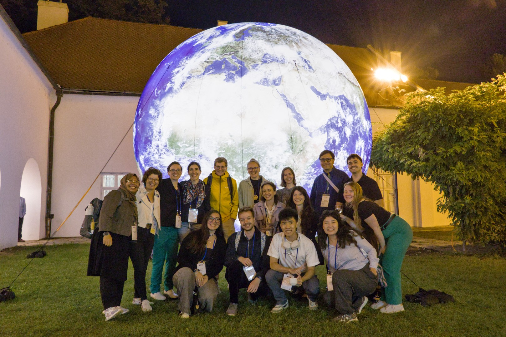
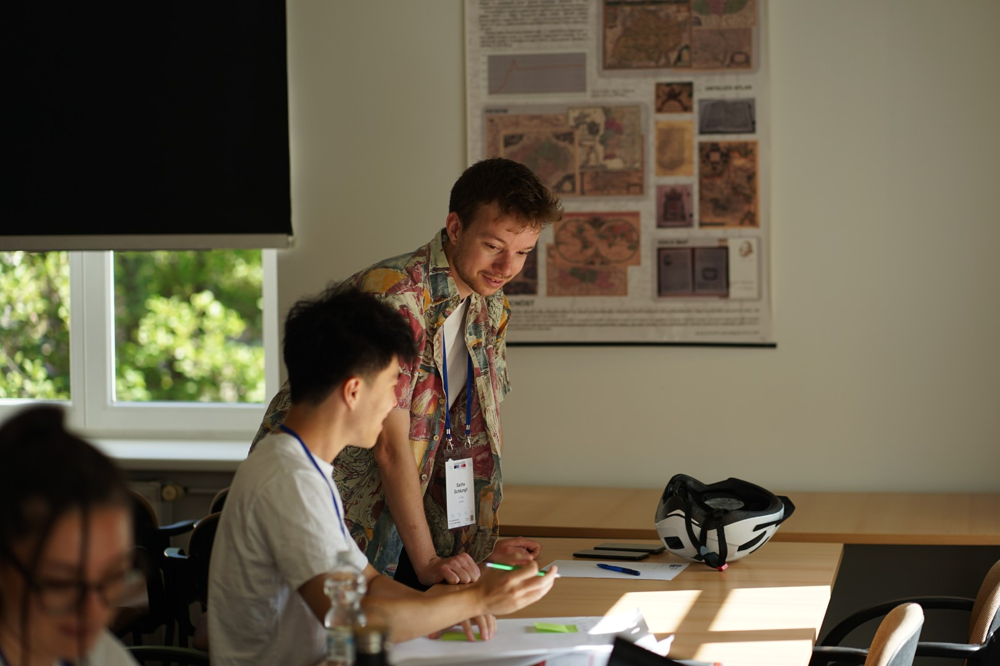
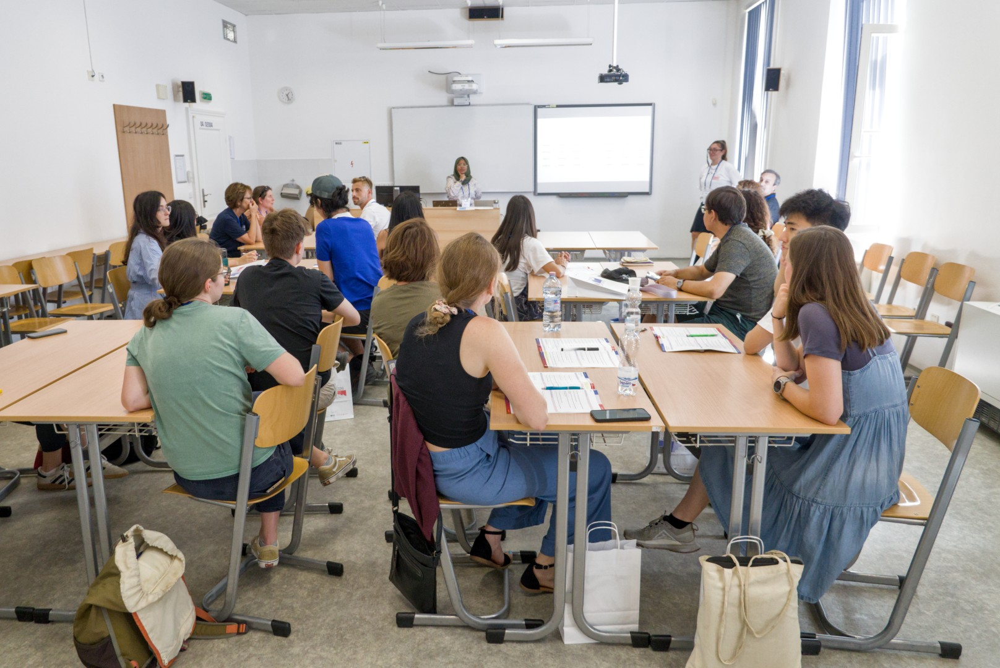
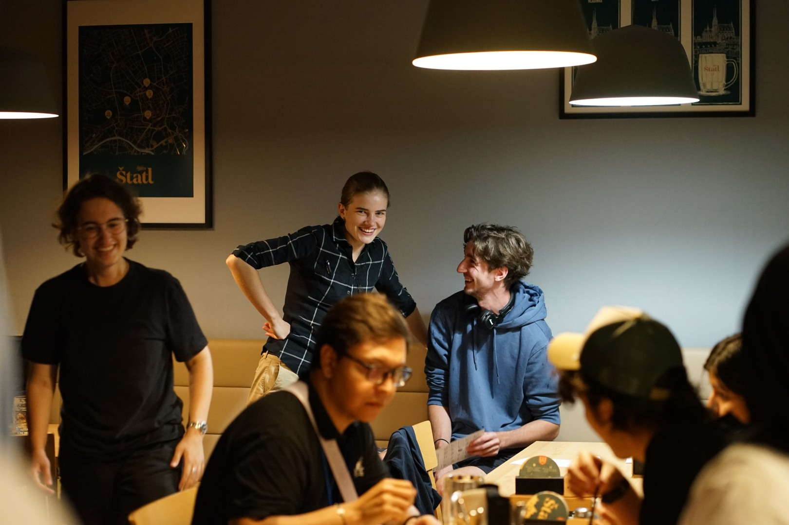
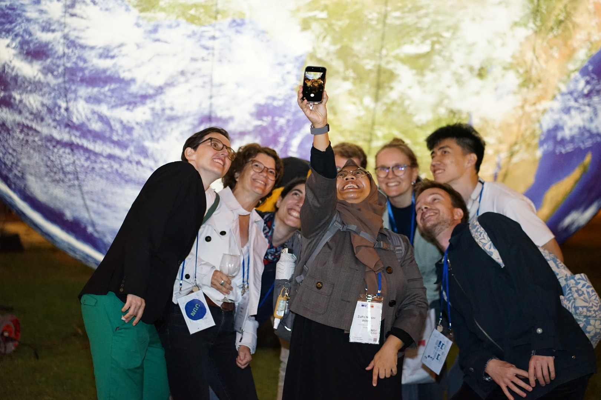

This year's European Cartographic Conference (EuroCarto) took place in Brno, Czech Republic, from September 8-11. NGC contributed with workshops, a social event, a business meeting, as well as many presentations by NGC members. You can find an overview of all our conducted activities [here](/activities/eurocarto-2026).

Jakob Listabarth and Sacha Schlumpf from NGC organized a **Map Tutorial workshop** that encouraged participants to share their tips and workflows in their mapmaking practices. During the workshop, participants formed groups to share their ideas and tips in their map production workflows, followed by a tutorial development section where participants were asked to document those thoughts. The workshop gathered a variety of tutorial topics spanning from styling vector tiles to practical map labeling. The workshop ended with an invitation for participants to further refine their tutorials to be published as part of our [NGC Map Tutorials](/resources/map-tutorials). The workshop encouraged mapmakers to emphasize epistemic knowledge in map production, elicit map production workflows, and diversify map production focuses and concerns. All these contributions remain essential under the current challenge to center human agency in the era of digital and AI transitions.

Additionally, NGC together with the ICA Commissions on User Experience, Education and Training, and Geovisualization hosted a **MentorMatch 2.0 workshop**. Following its successful debut at ICC 2025, MentorMatch returned for its second edition at EuroCarto 2026. Organized by Zulfa Nuraini Afifah, Juliane Cron, Merve Keskin, and Anthony Robinson, the interactive workshop brought together early-career and more experienced cartographers to offer guidance, share knowledge, and build meaningful connections. To prepare for the workshop, mentors and mentees completed a questionnaire outlining their interests, expertise, and expectations, including topics such as art, science, technology, education, and career development. Based on their responses, each mentor was matched with two to three mentees to encourage meaningful and relevant exchanges. The workshop kicked off with personal mentoring conversations, allowing participants to get to know each other and discuss individual questions and challenges. This was followed by an interactive "Ask Us Anything" session, where mentees could anonymously submit questions of broader interest, inviting all mentors to contribute their perspectives and advice. A big thank-you goes to all our mentors for generously sharing their time, knowledge, and personal experiences, and to all the enthusiastic mentees for their curiosity, openness, and active participation.

And the conversations did not stop there! Later that week, many young and early career cartographers met informally at our community meet-up at a local restaurant and bar. This evening was all about conversations, exchanging ideas building new connections and games. A big thanks to Anna Auermüllerová from the local organizers who supported us in organizing this event.

Thanks to the organisers' provision of plenty of food, a fun orienteering course, a collaborative map and much more, EuroCarto was a truly wonderful experience and brought a lot of young and early career cartographers together. We are very thankful to everyone who contributed. We highly recommend going on [the official EuroCarto2026 website](https://eurocarto2026.org/) to get some more impressions and photos. EuroCarto2028 will take place in Muttenz (Switzerland) on September 13-15.

*All photos by Masaryk University, Department of Geography*
