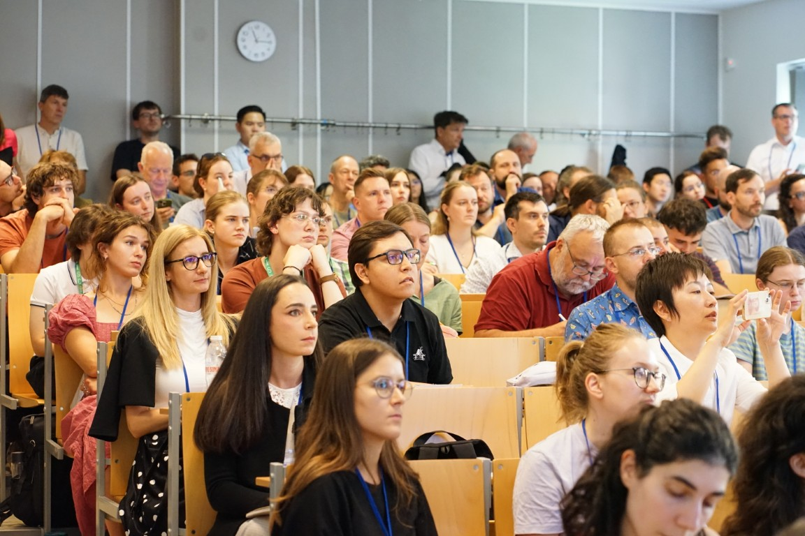
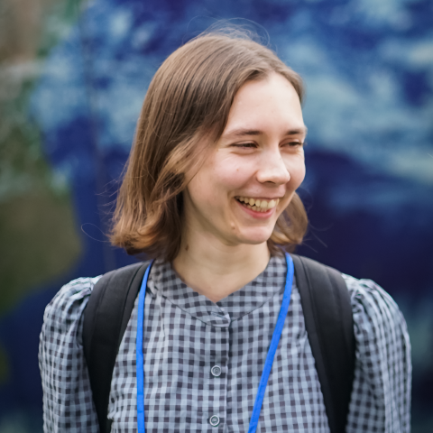
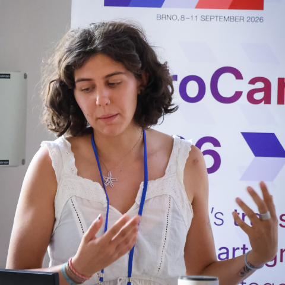

Many young people attended this year's European Cartographic Conference (EuroCarto) in Brno, Czech Republic. We asked two early career cartographers to share their experience.

## Martha Doffemont, Belgium’s National Geographic Institute (NGI)

"EuroCarto in Brno was the first ICA conference I visited. Aside from seeing many amazing maps, I wasn’t sure what to expect. I decided to go, in the first place, to keep up with new developments and research that is relevant to my work at Belgium's National Geographic Institute. And for that goal, EuroCarto definitely delivered: I learned about Spain’s national atlas, the SwissTopo basemap, labeling algorithms, and map symbology in general. In between attending talks about those topics, I had the chance to go to sessions about topics I hadn’t kept up with since finishing my studies. The atmosphere of the conference was friendly and welcoming, and it was easy to start talking with other attendees.

Everyone’s enthusiasm definitely motivated me to keep learning about cartography, and I’m looking forward to the next ICA conference!"

## Federica Ballardini, recent graduate of the Erasmus Mundus International Master in Cartography (Cartography MSc.)

"EuroCarto was a good experience, I would say. It was my second conference, but it was my first cartographic conference, and it was also the first one where I presented something, so I had this little added challenge. I think it really represented for me a lot of what the cartographic community is like — not just the academic community, actually, but industry and academia in cartography alike — which is very welcoming, very warm, very accepting, very fun, very open to change. It doesn’t feel like one of those stiff conferences where everything just has to be done a certain way. It was very fun, very spontaneous. I think I learned a lot as well, not just about the topics, but also about how these types of conferences work. 

I’m not looking to go into an academic life right now, but if I were, it gave me a lot of insight into how to use these conferences as a platform to reach more people and to get feedback, even if your work is not ready. I was under the impression that you only go to a conference when you have a paper that has been published, but it was really refreshing to see people just talking about their work in progress and where they’re standing right now. That was really interesting to see. Overall, I think it was a well-organized conference. It was fun; everything felt very smooth, and it had interesting topics."

  
*All photos by Masaryk University, Department of Geography*
